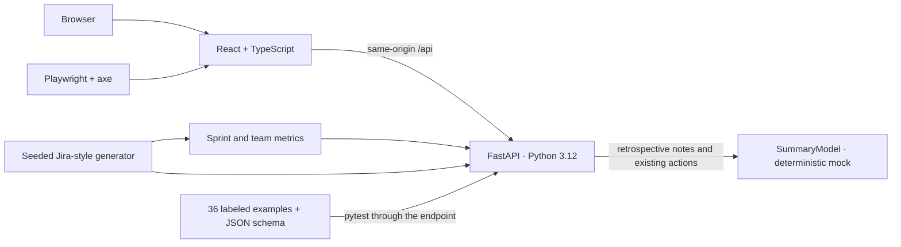
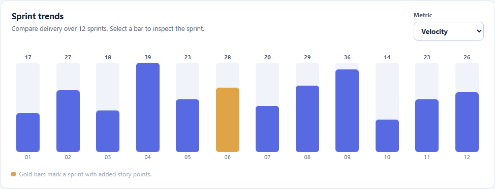
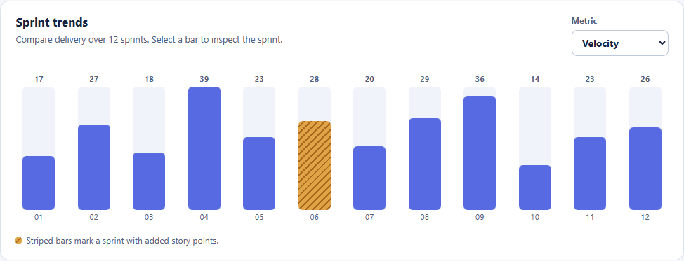
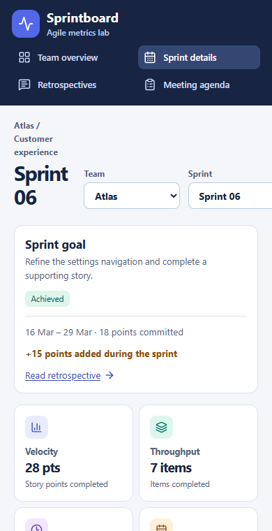
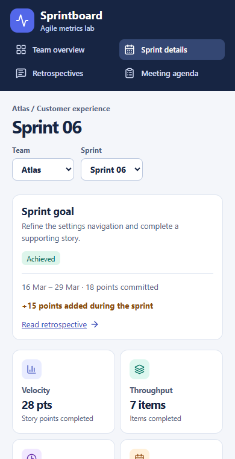

# Sprintboard · Agile Metrics AI QA Lab

Sprintboard is an interactive training demo for three Scrum teams. Every team, issue, sprint goal and retrospective note is synthetic. CI uses a deterministic mock for the AI summary. GitHub Actions runs the entire lab on Linux with Python 3.12 and Node 22, using public dependencies and a local browser. The workflow requires no added accounts, API keys, Docker, or cloud services.

[](https://github.com/hamza2829/agile-metrics-ai-qa-lab/actions/workflows/ci.yml)

## Explore the dashboard

- **Team overview** compares a team's last 12 sprints. Switch the trend metric and select a bar to open a sprint.
- **Sprint details** show the goal, issue history, actual and ideal burndown, and the data behind the chart. Atlas Sprint 06 adds 15 points after kickoff. Atlas Sprint 04 includes a story carried over from Sprint 03. Cedar has slower cycle times.
- **Retrospectives** show what went well, what to improve, and action owners. The mock groups notes into themes, links to the supporting notes, and surfaces existing actions.
- **Meeting agenda** uses the selected sprint to propose timeboxes for Planning, Review, and Retrospective.

See the [10-minute demo script](DEMO.md) and [new team member training guide](TRAINING.md).

## Architecture



The default seed is `2026`. The generator creates 12 shared two-week periods and a separate sprint record for each of the three teams in every period. Issue histories are UTC. Sprint close is an exclusive boundary for status events. The [training guide](TRAINING.md#read-the-six-metrics) gives the formulas and a worked example for every metric.

## Run locally

These Linux commands are optional. CI does this automatically on each push to `main` and every pull request.

```bash
python3.12 -m venv .venv
source .venv/bin/activate
python -m pip install -r api/requirements-dev.txt
npm ci --prefix web
(cd api && python -m uvicorn lab.app:app --host 127.0.0.1 --port 8000)
```

In a second terminal, run `npm run dev --prefix web` and open the [dashboard](http://127.0.0.1:4173). FastAPI serves [interactive API docs](http://127.0.0.1:8000/docs).

Export a fixture with `(cd api && python -m lab.data --seed 2026 --out ../synthetic-sprints.json)`. For a local browser run, stop the two development servers first and use the activated virtual environment.

```bash
npm run build --prefix web
(cd web && npx playwright install chromium && npm run test:e2e)
```

## AI-assisted development

Codex drafted the React and TypeScript prototype. Claude Code's authentication check found no usable signed-in session, so Claude Code made no contribution. Follow-up edits changed the trend legend contrast and the narrow-screen header layout after measuring the initial browser build. The metrics were checked independently against hand-calculated examples.

## UX findings

1. **Chart legend contrast.** Axe measured the small legend text at 2.37:1 against white. A darker text color raised it to 6.26:1 and cleared the axe finding. The chart links now include their visible values in their accessible names, and stripes identify added scope.
2. **Mobile sprint controls.** At 390 px, the document was 408 px wide and the sprint selector clipped. Stacking the heading above a responsive control grid brought the page width to 390 px and kept both controls visible.

| Finding | Before | After |
| --- | --- | --- |
| Chart legend |  |  |
| Mobile header |  |  |

The images are browser captures from the original and corrected builds. CI also captures the corrected pages and uploads the images with the axe and test reports.

## Verified QA results

<!-- verified-results:start -->
**66/66 tests passed.**

| Suite | Passed | Failed | Skipped |
| --- | ---: | ---: | ---: |
| Pytest | 36 | 0 | 0 |
| Vitest | 12 | 0 | 0 |
| Playwright | 18 | 0 | 0 |

Theme evaluation on **36 labeled samples**.

| Metric | Observed |
| --- | ---: |
| Micro precision | 97.30% |
| Micro recall | 94.74% |

36 true positives, 1 false positives, and 2 false negatives.

Playwright ran 12 browser flows and 6 axe scans, including the mobile sprint page.
<!-- verified-results:end -->

The theme evaluator counts predicted and expected labels for each sample, then pools true positives, false positives and false negatives. The regression test compares both scores to exact fractions in the [baseline](api/tests/fixtures/theme-baseline.json). A drop in either score fails CI. Separate tests check evidence references, action grounding, empty and oversized input, mixed German and English, instructions inside notes, and an independent [JSON Schema](api/tests/fixtures/summary.schema.json). The artifact includes JUnit, the Playwright HTML report, case-level AI scores, axe JSON, and screenshots.

## Limits

- All data is synthetic and read-only. The generator runs locally and has no Jira connection.
- The mock runs in CI and in the local demo. It recognizes a small bilingual vocabulary and can miss paraphrases or match an ambiguous word.
- Suggested actions come from the recorded list. The measured scores apply to the fixture and mock. A live model would need its own evaluation.
